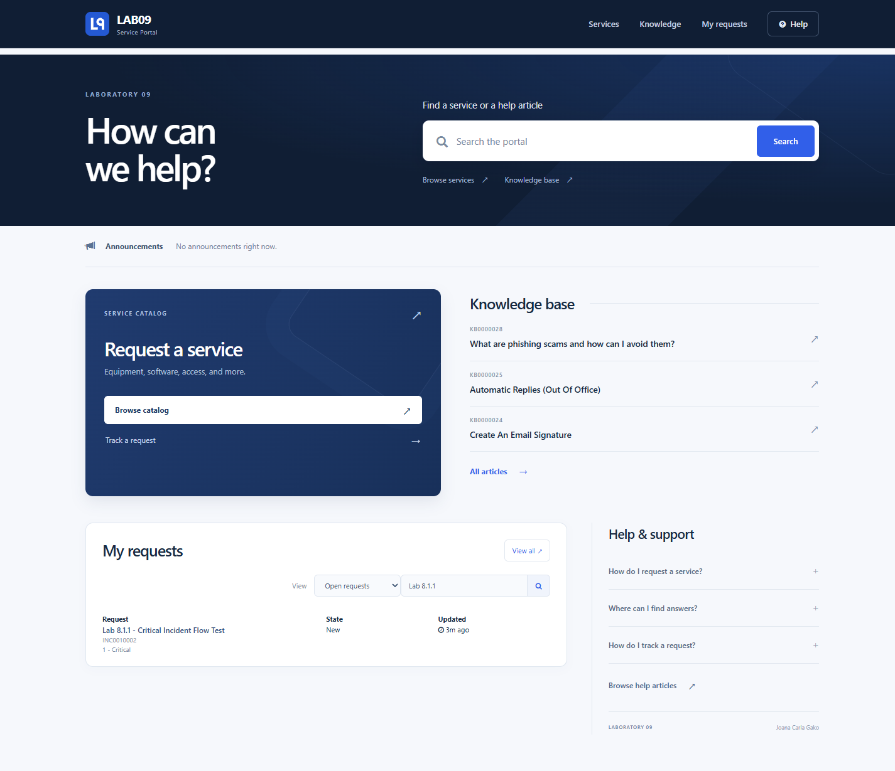

# LAB09 Service Portal

A ServiceNow Service Portal for Laboratory 09 by Joana Carla Gako. Find services, read knowledge articles and track requests in a responsive navy-and-blue interface.

[Open the deployed portal](https://dev431102.service-now.com/gako_lab09?id=gako_lab09_home) · [Student workbook](submission/Student%20Output%20Template%20(Gako).xlsx) · [Update Set XML](submission/GAKO_JoanaCarla%20Hello%20World%20Portal.xml)

## Required page structure

| Actual Service Portal container | Two active direct widget instances |
|---|---|
| Welcome & announcements | Welcome/search; Announcements |
| Services & knowledge | Service catalog; Knowledge base |
| Requests & help | My requests; Help/FAQ |

**3 real containers, 6 real widget instances.** The header and embedded native widgets are additional components. No tickets, users, knowledge articles or catalog items were seeded.

Built with the installed **ServiceNow SDK 4.14.0**, its ServicePortal, SPPage, SPWidget and SPTheme Fluent APIs, AngularJS 1.8.3 and Bootstrap 3.4.1. The logo and CSS artwork are original. Existing internal record IDs were preserved during the redesign.

## Source and local preview

Run `npm ci`, `npm run build` and `npm run verify:local`. Use `npm run preview` to open the source preview at http://127.0.0.1:4173. The local preview uses genuine empty placeholders for native widgets. Live native data requires ServiceNow.

The Fluent declaration is in [src/fluent/midnight.now.ts](src/fluent/midnight.now.ts). Templates, AngularJS controllers, server scripts and SCSS are in [src/portal](src/portal).

## Native functionality

- Safe URL-encoded search opens the verified native search page.
- Catalog links open existing eligible items and request forms.
- Knowledge previews use GlideRecordSecure, published/nonexpired filters and `$sp.canReadRecord`.
- My Requests embeds verified native widget `8cc0df25875023000f220cf888cb0bb5`, with native open/closed filtering, search and a link to the full requests page.
- Announcements uses native widget `94c300c7e777320075c2a117c2f6a9e7` and its visibility-filtered announcement service. An empty state is shown when appropriate.
- Header links, mobile navigation and keyboard FAQ work. Motion respects the user's preference.

## Submission and verification

The completed Update Set is **GAKO_JoanaCarla Hello World Portal**, sys_id `82b45c2e2f5453108b2f298a6fa4e34c`, with **46 Customer Updates**. Native Publish to Update Set and Export to XML were used, with demo data excluded. The export includes the original logo and four DELETE actions retiring the old image properties. No movie imagery is packaged.

Use the current files in [submission](submission). The student workbook preserves the supplied template and embeds the actual full-page screenshot. Block/Section is blank because it was not supplied. The public screenshot uses native request search to show only the existing Lab 8.1.1 request.

[Created records](docs/RECORDS.md) · [Deployment result](docs/DEPLOYMENT-RESULT.md) · [Verification and screenshot checklist](docs/DEPLOYMENT.md) · [Export integrity](docs/validation/export.json)

Default portals were not modified. Validation used the authenticated admin account. Non-admin eligibility and import/commit on another instance remain untested; the verified OOTB IDs must exist on a target instance.

## Official references

[Service Portal guide for SDK 4.14.0](https://servicenow.github.io/sdk/4.14.0/guides/service-portal-guide), [component guide](https://servicenow.github.io/sdk/4.14.0/guides/service-portal-components-guide), and [Publish to Update Set](https://www.servicenow.com/docs/r/application-development/t_PublishApplicationsToAnUpdateSet.html).
